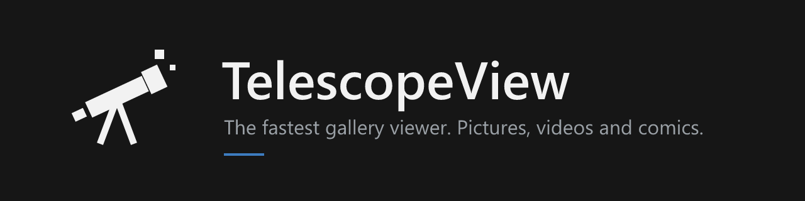

<p align="center">
  
</p>

<p align="center">
  <a href="https://github.com/bani4kaskashka/TelescopeView/actions/workflows/build.yml"></a>
  <a href="https://github.com/bani4kaskashka/TelescopeView/releases/latest"></a>
  
  
  <a href="#license"></a>
</p>

<p align="center">
  <b>Pictures, videos and comics. One fast app for all of it.</b><br>
  Open the formats other apps won't. Edit and crop pictures, save frames from videos,<br>
  clear out duplicates, and read comics, manga and webtoons, all in one window.
</p>

<p align="center">
  <a href="#download">Download</a> ·
  <a href="docs/GUIDE.md">User guide</a> ·
  <a href="#building-from-source">Build from source</a> ·
  <a href="CHANGELOG.md">Changelog</a>
</p>

---

## Why TelescopeView

Most viewers make you wait for each picture, then send you to another program to do anything with
it. TelescopeView works ahead of you, and keeps the tools where you already are:

- **Preloading in the background.** A pool of decoder threads keeps the pictures around the
  current one ready, and looks further ahead when you flip fast. The current picture stays on
  screen until the next one is fully ready, so flipping through a folder doesn't flicker or wait.
- **Instant, measured.** With 24-megapixel JPEGs on a Ryzen 7 5700X, every step was instant at
  6, 15 and 30 pictures per second. Set `IV_STATS=1` to log it on your own machine.
- **One app for the whole folder.** Photos, camera RAW, HEIC, JPEG XL, EXR, DDS, PSD, SVG,
  videos and comic archives all sit in the same gallery, so you never switch apps halfway
  through a folder.
- **The tools are right there.** Fix a photo, crop it, save a frame from a video or clear out
  duplicates without opening a second program.
- **Light on the system.** One GPU upload per frame at most, and zero CPU use while idle.
- **Out of the way.** A flat, square, minimal interface with dark, light and high-contrast
  themes. The toolbar keeps to the everyday buttons; everything else lives one click away.

## Features

| | |
|---|---|
| **Viewing** | Fit to window or width, zoom, zoom lock for comparing shots, enlarge small images, rotate and flip (saved losslessly into JPEGs), fullscreen, slideshow, an optional glide between images |
| **Picture editor** | Dials for light balance, brightness, exposure, contrast, highlights, shadows, saturation, tint, temperature, sharpness, definition and straighten. Crop with free, original or fixed ratios, undo and redo, and a before/after line to drag. EXIF and the color profile are kept |
| **Find duplicates** | Scan a folder for exact copies and look-alikes, then go through them in pairs. Nothing is deleted until you confirm on the last page, and then it goes to the Recycle Bin |
| **Pick a frame** | Split a video into every frame as a grid and save any of them at full resolution as PNG or JPEG. It never overwrites a file |
| **Comics and manga** | Two-page spreads (cover alone, wide scans alone), right-to-left reading, split wide pages, chapter-to-chapter reading, go to page |
| **Webtoons** | Turn a folder into one long vertical strip, with adjustable column width and auto-scroll |
| **Bookmarks** | Bookmark any page, see it on the page bar, and save it as a `.tvmark` file that reopens right there |
| **Thumbnails** | A strip that slides out from any edge of the window, plus page previews on the position bar |
| **Photos** | Camera, lens, exposure, date taken and GPS location from EXIF in the info panel |
| **Animations and videos** | GIF, APNG and animated WebP with pause and frame stepping; videos with sound through ffmpeg |
| **Files** | Copy, paste, rename, move, delete to the Recycle Bin, set as wallpaper, show in Explorer |
| **Resume** | Every folder reopens where you left it, even when an external drive comes back under another letter |
| **Your way** | Every shortcut can be changed, every toolbar button shown or hidden, interface size from 100 to 200% |

See the **[user guide](docs/GUIDE.md)** for everything it does and every shortcut.

TelescopeView keeps growing, and more tools are on the way. Image upscaling is coming soon.

## Supported formats

| Kind | Formats |
|---|---|
| **Images** | PNG, APNG, JPEG, WebP, GIF, BMP, TIFF, ICO, TGA, QOI, PNM, HDR, EXR, DDS, Farbfeld, JPEG XL, SVG, PSD |
| **Windows extras** | Anything with an installed Windows codec: HEIC / HEIF, AVIF, JPEG XR and camera RAW (DNG, CR2, CR3, NEF, ARW and more) |
| **Comics and books** | CBZ / ZIP, CBR / RAR, CB7 / 7Z, CBT / TAR, EPUB (picture books and comics), PDF (Windows) |
| **Videos** | Anything ffmpeg plays: MP4, MKV, WebM, MOV, AVI, WMV and more, with sound (ffmpeg comes with the Windows downloads and the Linux `.zip`) |

## Download

Get the latest build from the **[Releases page](https://github.com/bani4kaskashka/TelescopeView/releases/latest)**.
Every build comes for both x64 (Intel / AMD) and ARM64, as an installer or as a portable app.

| Platform | Installer | Portable |
|---|---|---|
| **Windows 10 / 11** | `TelescopeView-<version>-windows-x64-setup.exe`<br>`TelescopeView-<version>-windows-arm64-setup.exe`<br>Installs for your user only (no admin), adds a Start menu entry and an uninstaller. | `TelescopeView-<version>-windows-x64.zip`<br>`TelescopeView-<version>-windows-arm64.zip`<br>Unzip anywhere and run `TelescopeView.exe`. |
| **macOS** (one app for Apple silicon and Intel) | `TelescopeView-<version>-macos-universal.dmg`<br>Drag the app onto Applications. | `TelescopeView-<version>-macos-universal.zip`<br>Just the app. |
| **Linux** | `telescopeview_<version>-1_amd64.deb`<br>`telescopeview_<version>-1_arm64.deb` | `TelescopeView-<version>-linux-x64.zip`<br>`TelescopeView-<version>-linux-arm64.zip`<br>Run `telescopeview`, or `./install.sh` for a menu entry (`./uninstall.sh` removes it). |

- **Videos work out of the box** on Windows and Linux: the installers and zips carry a portable
  ffmpeg, which is why the Windows download is about 73 MB. The `.deb` uses your distribution's
  ffmpeg. On a Mac, install it once with `brew install ffmpeg`.
- **Not code-signed yet.** On Windows, SmartScreen asks once: choose **More info**, then
  **Run anyway**. On a Mac, right-click the app and choose **Open** the first time.
- **Checksums.** Every release lists the SHA-256 checksum of each file in `SHA256SUMS.txt`.

## Quick start

Open a picture (double-click, drag it onto the window, or Ctrl+O) and use the arrow keys.

| Key | Action | Key | Action |
|---|---|---|---|
| ← → | Previous / next | F | Fit to window |
| F11 | Fullscreen | W | Fit to width |
| S | Slideshow | 1 | Actual size |
| R | Rotate | E | Enlarge small images |
| N | Thumbnails | I | Info and EXIF |
| V | Webtoon strip | B | Bookmark the page |
| P | Two-page spread | G | Go to page |
| M | Right to left (manga) | H | Every shortcut |
| Shift+E | Edit the picture | | |

The pencil in the top bar opens the editor too. Find duplicates and Pick a frame are in the **...**
menu. Settings are under the sliders button in the toolbar, or Ctrl+,.

## Making it your default viewer

In the **...** menu, choose **Make default** and tick what TelescopeView should open: pictures,
RAW photos, videos, comics, or single formats. Everything you leave unticked stays with the app
that opens it now.

- **Windows:** TelescopeView registers the ticked types and opens its own Default apps page in
  Settings, where you pick it for each type (Windows doesn't let apps set themselves as the
  default). It also registers for "Open with" on first start, for the current user only.
- **Linux:** **Make default** sets it as the default for the ticked types through `xdg-mime`.
  `install.sh` from the `.zip` (or the `.deb`) adds the menu entry and "Open with".
- **macOS:** open files from inside the app or drop them on the window. Finder's "Open With"
  is not supported yet.

## Building from source

You need [Rust](https://rustup.rs) (stable) and a C++ compiler for CBR / RAR support.

```sh
git clone https://github.com/bani4kaskashka/TelescopeView.git
cd TelescopeView
cargo build --release
```

The program is `target/release/TelescopeView` (`.exe` on Windows). To build without RAR
support, and without the C++ compiler, use `cargo build --release --no-default-features`.

| Platform | Package | Command |
|---|---|---|
| Windows | installer and `.zip` | `packaging/build-windows.ps1 -Arch x64` (or `arm64`); the installer needs [Inno Setup 6](https://jrsoftware.org/isinfo.php) |
| macOS | `.dmg` and `.zip` (universal) | `sh packaging/build-macos.sh` on a Mac |
| Linux | `.zip` and `.deb` | `sh packaging/build-linux.sh` (needs `libxkbcommon-dev libgl1-mesa-dev libasound2-dev`); for ARM64 set `TARGET=aarch64-unknown-linux-gnu` (built through [`cross`](https://github.com/cross-rs/cross)) |
| Everything | GitHub release | Push a `v*` tag. [`build.yml`](.github/workflows/build.yml) builds all of the above and publishes them. |

See [CONTRIBUTING.md](CONTRIBUTING.md) for the project layout and how to send changes.

## Where settings live

| Platform | Folder |
|---|---|
| Windows | `%APPDATA%\TelescopeView` |
| macOS | `~/Library/Application Support/TelescopeView` |
| Linux | `~/.local/share/telescopeview` |

## Known limits

- PDF pages need Windows (TelescopeView uses the PDF reader built into Windows).
- EPUB: picture books and comics only. Text-only novels have no pages to show.
- The editor works on pictures, not animations or videos. To crop something from a video, save
  the frame first. Saved files are 8-bit per channel, and pictures over 64 MP can only be saved as
  a smaller copy.
- Find duplicates doesn't find rotated or mirrored copies.
- Only the Windows x64 build has been tested on real hardware so far. The ARM64, macOS and
  Linux builds are made on GitHub's build machines and haven't been tried on a real device yet.
  Reports are very welcome.

## License

TelescopeView is dual-licensed under either of

- [MIT License](LICENSE-MIT)
- [Apache License, Version 2.0](LICENSE-APACHE)

at your option. Unless you explicitly state otherwise, any contribution you submit for inclusion
in TelescopeView is dual-licensed as above, without any additional terms or conditions.

CBR / RAR support uses the [UnRAR](https://www.rarlab.com/rar_add.htm) library, which comes under
its own license (free to use for extracting, not for creating RAR archives). Build with
`--no-default-features` to leave it out.

The Windows downloads and the Linux `.zip` files include [FFmpeg](https://ffmpeg.org) (an LGPL build from
[BtbN/FFmpeg-Builds](https://github.com/BtbN/FFmpeg-Builds)) in their `ffmpeg/` folder.
TelescopeView runs it as a separate program for video playback. FFmpeg is licensed under the
GNU LGPL 2.1 or later; its license text is in `ffmpeg/LICENSE.txt`, and its source code is
available at <https://ffmpeg.org/download.html>.
